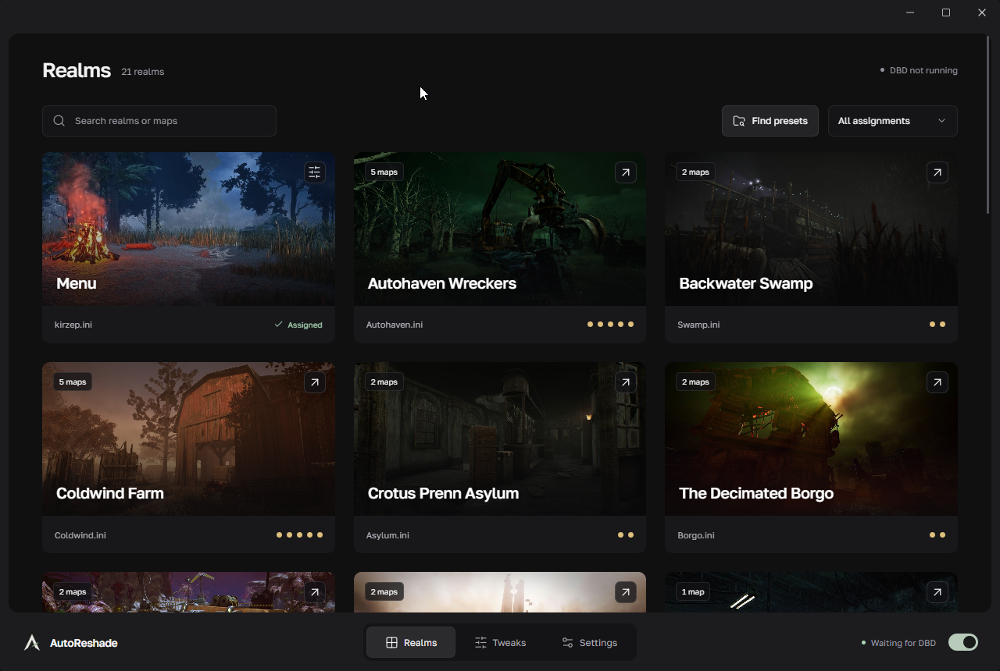
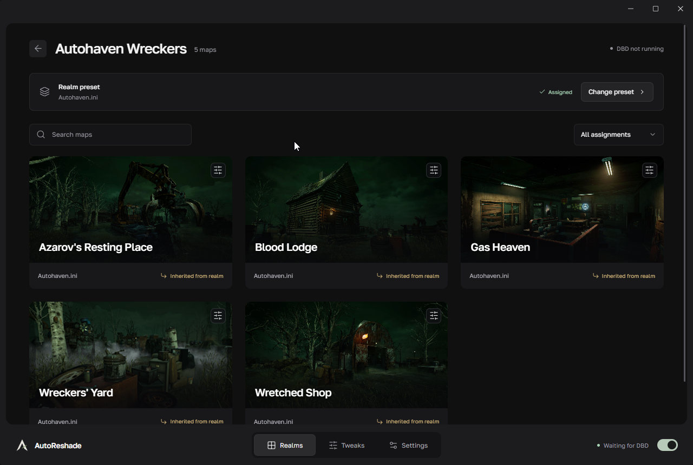
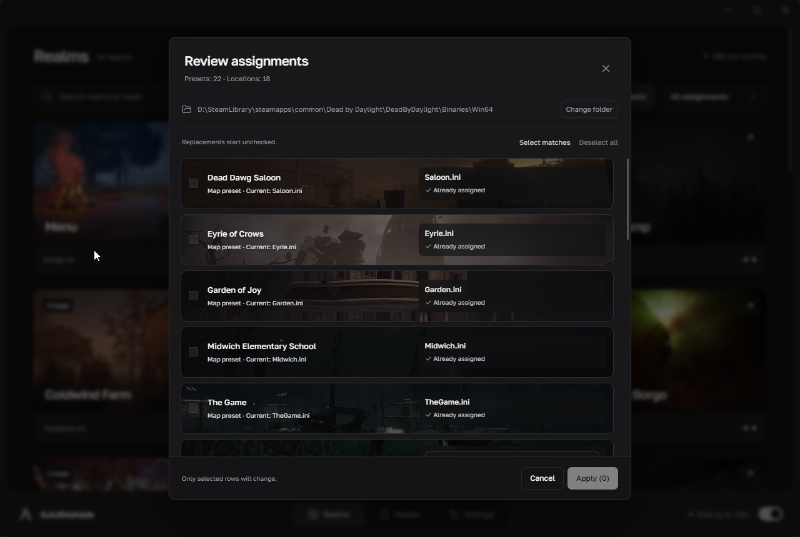

<h1>AutoReshade</h1>

Automatic ReShade preset switching for Dead by Daylight

<a href="README.ru.md">Русская версия</a> · <a href="https://github.com/kirzep/DBDAutoReshade/releases/latest">Portable ZIP and release files</a>

Use different ReShade presets for different maps and tired of switching them by hand? AutoReshade detects the map you load into and switches the preset for you. Assign a preset to a realm or an individual map once, and AutoReshade applies it automatically when you play there.

## Screenshots

More screenshots

## Getting started

1. Download and run the installer using the button above.
2. In the setup wizard, select your game folder and your ReShade presets folder.
3. Assign your presets and turn on automatic switching.

Requires **Windows 10 or 11 x64**, Dead by Daylight, and ReShade. Set the game language to **English** so AutoReshade can recognize map names. The app interface is available in English and Russian.

## What's new in 0.3.7

- Preset changes update ReShade.ini automatically when DBD is closed. Changes made during play are applied after the game closes.
- Find Presets can select clear replacements in bulk, even when a preset is already assigned.
- Settings shows the installed version and lets you check for updates.
- The VirtualResolution panel offers a clear install action when the shader is missing.

[Report an issue](https://github.com/kirzep/DBDAutoReshade/issues)
