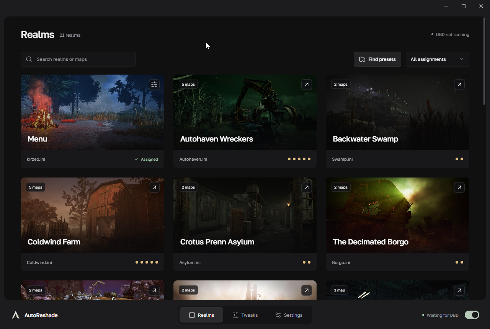
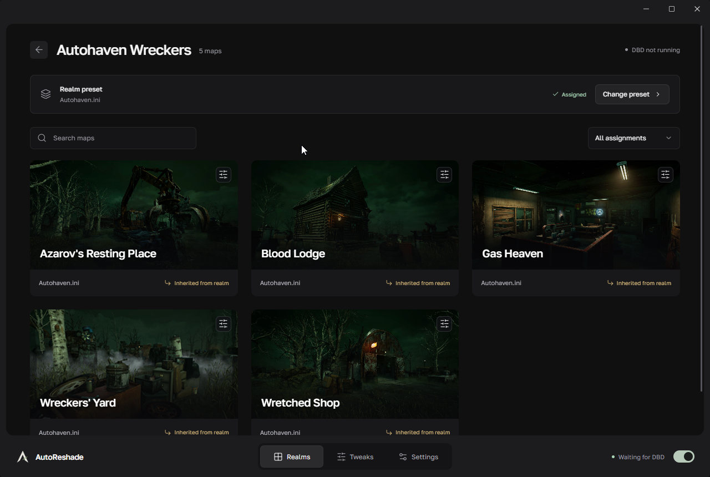
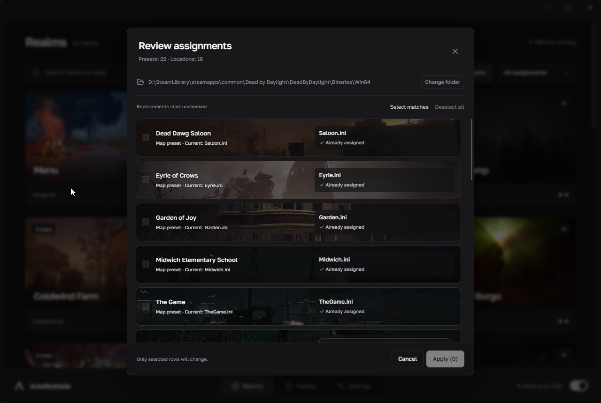

<h1>AutoReshade</h1>

Автоматическая смена пресетов ReShade в Dead by Daylight

<a href="README.md">English</a> · <a href="https://github.com/kirzep/DBDAutoReshade/releases/latest">Portable ZIP и файлы выпуска</a>

Пользуетесь разными пресетами ReShade для разных карт и устали переключать их вручную? AutoReshade определяет, на какую карту вы загрузились, и меняет пресет за вас. Один раз выберите пресет для измерения или отдельной карты, и программа будет применять его при загрузке.

## Скриншоты

Ещё скриншоты

## Установка

1. Скачайте установщик по кнопке вверху и запустите его.
2. В мастере настройки укажите папку игры и папку со своими пресетами ReShade.
3. Назначьте пресеты и включите автоматическое переключение.

Нужны **Windows 10 или 11 x64**, Dead by Daylight и установленный ReShade. AutoReshade распознаёт названия карт **на русском и английском**. В разделе **Настройки → Распознавание** укажите тот же **Язык текста в игре**, что и в DBD. В Windows должен быть установлен компонент «Распознавание текста» для выбранного языка. Интерфейс AutoReshade доступен на русском и английском.

## Что нового в 0.3.10

- Добавлено распознавание русских названий карт и подсказки «Сведения о матче».
- Добавлено предупреждение, если язык DBD отличается от языка распознавания.
- Улучшено чтение бледных названий карт. Поиск реже запускается повторно при появлении подсказки о матче.

[Сообщить об ошибке](https://github.com/kirzep/DBDAutoReshade/issues)
